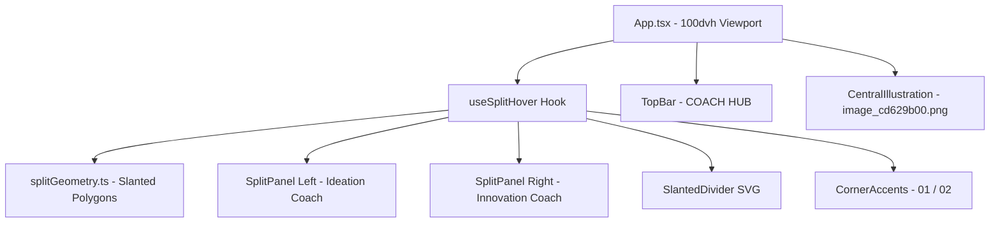

# Coach Hub — Ideation & Innovation Gateway

[](./.github/workflows/deploy.yml)
[](https://react.dev/)
[](https://www.typescriptlang.org/)
[](https://tailwindcss.com/)
[](https://vitest.dev/)

A responsive, full-viewport (`100dvh`) slanted 50/50 split-screen gateway connecting **Ideation Coach** and **Innovation Coach**.

## Key Features

- **Slanted 50/50 Split Architecture**: Diagonal CSS `clip-path` divider (`54%` top to `46%` bottom on desktop; slanted horizontal seam on mobile) that dynamically shifts to `55/45` on hover or keyboard focus with a `0.4s` easing curve.
- **Duotone Editorial Palette**:
  - **Left Panel (Ideation Coach)**: Vibrant magenta-pink (`#FF85B3`) with crisp white typography and direct launch link to `https://ideation-coach.vercel.app/`.
  - **Right Panel (Innovation Coach)**: Bold warm amber (`#FFD21F`) with deep charcoal (`#1A1A1A`) typography, warm orange-red (`#D93800`) accents, and direct launch link to `https://innovation-coach.vercel.app/`.
- **Dynamic Central Lightbulb**: Transparent watercolor lightbulb (`image_cd629b00.png`) centered on the slanted seam with a duotone glow halo that glides synchronously with the moving divider line, flanked by non-overlapping outer-aligned text blocks.
- **Minimalist Editorial Chrome**:
  - Top-left `COACH HUB` wordmark reset control and bottom-right interactive `01 / 02` panel indicator.

## Architecture



## Local Setup

```bash
# Install dependencies
npm install

# Start development server on port 3000
npm run dev

# Run TypeScript type-check
npm run lint

# Run Vitest unit & integration test suite
npm test

# Build production bundle
npm run build
```

## Deployment

Pushing to `main` triggers `.github/workflows/deploy.yml`, which runs type-checking, automated Vitest tests, and builds the static bundle with `VITE_BASE_PATH` configured for GitHub Pages.
